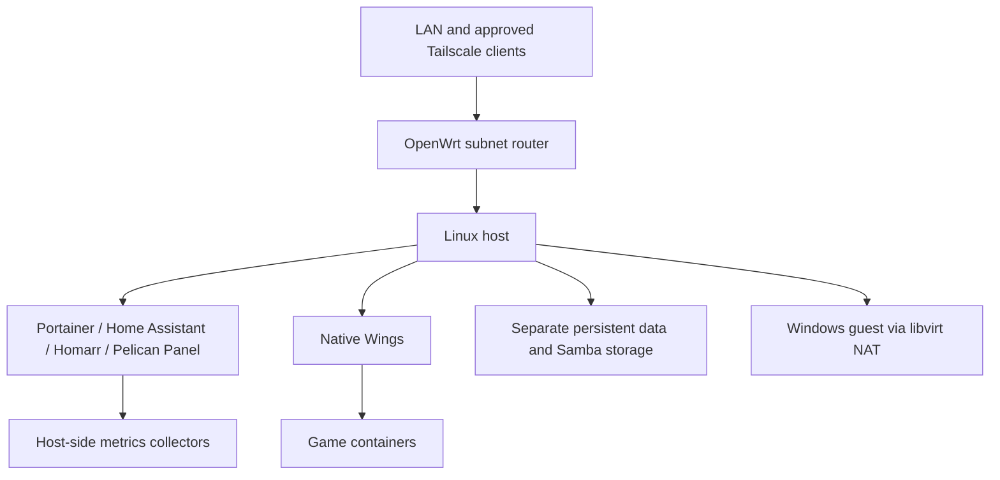

# Architecture

A low-power Linux host runs Docker applications, native Wings, host-side monitoring collectors, Samba and a libvirt Windows guest. OpenWrt provides LAN routing and a Tailscale subnet route. Pelican Panel controls Wings-owned game containers; Homarr presents metrics from local collectors.

The operations manual records the application/game setup as operational at its snapshot. Later RDP changes were proposed and UDP testing remained incomplete. These are historical records, not a fresh audit.

## Later chat reconciliation

See [25 November changes](Changes-2026-11-25.md), [router DNS](Router-DNS.md), [applications](Application-Updates.md) and [access/retired work](Access-and-Retired-Experiments.md). These supersede older inventory statements where explicitly identified. This update used chat evidence, not a live audit.
