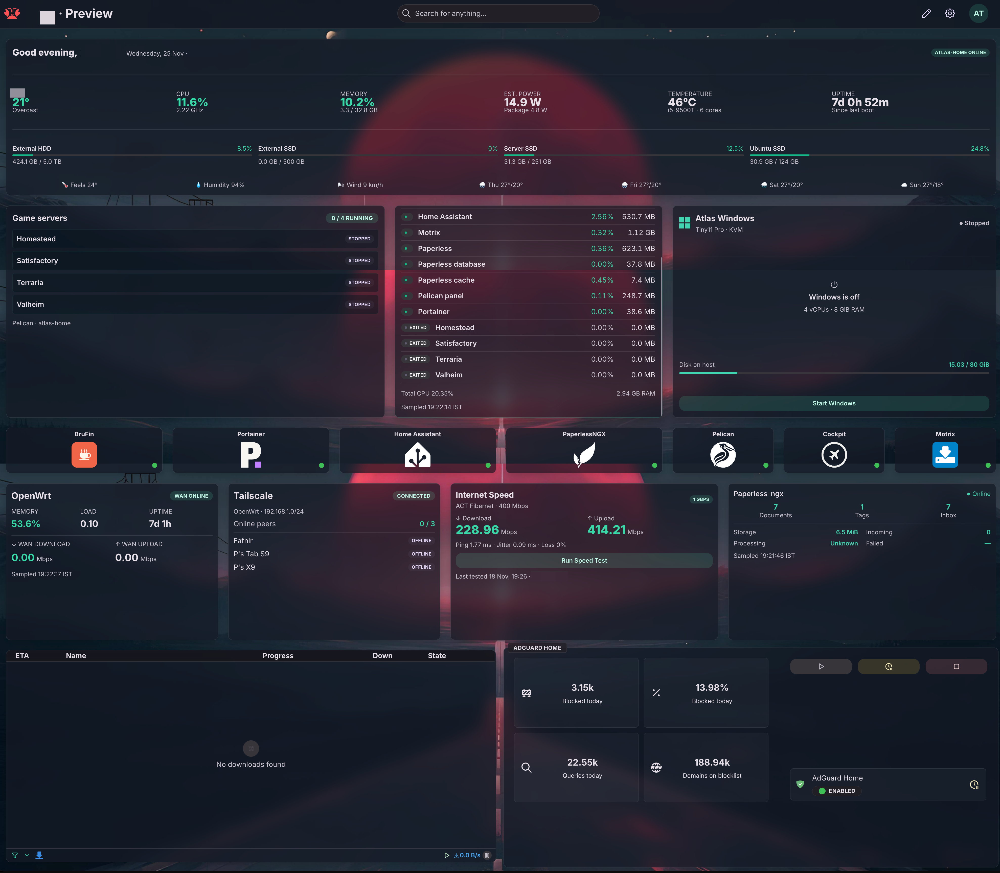

# Homelab Wiki

Sanitized documentation for a low-power Linux homelab: Docker applications, game servers, storage, monitoring, remote access and a Windows VM.

## Dashboard

Dashboard preview from 25 November 2026, supplied and redacted by the owner. Published as provided, without further image editing.

Start with [Home](Home.md), [Services and ports](Services-and-Ports.md), [Service interaction diagram](Service-Interaction-Diagram.md) or [Command reference](Command-Reference.md).

Real addresses, account names, disk identifiers, private paths and credential locations have been removed or replaced with placeholders. Commands are templates: HOST_IP, GUEST_IP, ROUTER_IP, ROUTER_WAN_IP, UPSTREAM_IP, LAN_CIDR, ADMIN_USER, LAN_INTERFACE and VM_BRIDGE require local substitution. lab-prefixed names are illustrative.

This is a historical documentation snapshot, not a live host audit. Unknown ports and inferred dependencies remain labeled. No secrets are included.

## Update — 25 November 2026

- [Changes-2026-11-25](Changes-2026-11-25.md)
- [Router-DNS](Router-DNS.md)
- [Application-Updates](Application-Updates.md)
- [Access-and-Retired-Experiments](Access-and-Retired-Experiments.md)

The screenshot shows the redesigned preview board; displayed readings are a snapshot, not a live service-status report.
