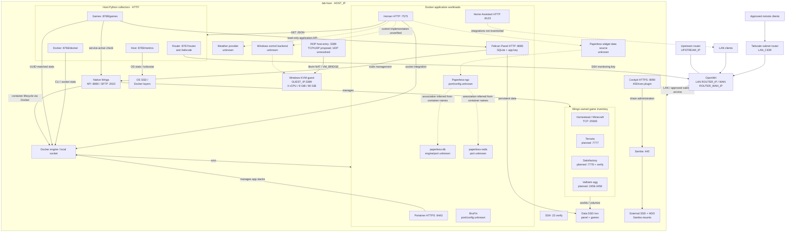

# Service interaction diagram

Solid arrows show relationships recorded in the supplied manual. Dotted arrows indicate an inferred dependency or unknown implementation. None are a live audit. Group containment means deployment location; it does not mean every client can reach every port. Ports without a protocol qualification are recorded service ports, not a verified transport inventory.

## Read the main flows

- Administration: LAN/Tailscale → host → SSH, Cockpit or application UI; Portainer manages app stacks through Docker.
- Games: Panel → native Wings → Docker game containers → /srv. Game clients use allocations, not the Panel or Wings management ports.
- Dashboard: Homarr → collectors → host statistics, Docker, router SSH and panel API. A shortcut tile alone does not establish an API integration.
- Documents: Paperless and its named database/Redis companions appear in the screenshot. Their exact configuration and dashboard data path need local retrieval.
- Windows: host RDP entry → libvirt NAT → guest; the dashboard start control exists visually, but its backend is unknown.
- Storage: OS/Docker layers remain on root; app/game persistence uses /srv; Samba exposes existing external mounts.

See [20 - Services and Ports](Services-and-Ports.md) and [22 - Command Reference](Command-Reference.md).
